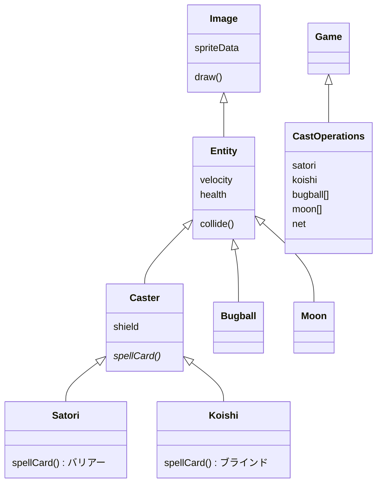

# Toho Classic Socket Game

## 使用技術スタック

| カテゴリ | 技術 |
|---------|------|
| 言語 | C++ |
| ビルド | Visual Studio 2017 (v141) |
| プラットフォーム | Windows (Win32) |
| グラフィックス | DirectX 9 |
| オーディオ | XACT3 |
| ネットワーク | Winsock2 (TCP/UDP) |
| 入力 | DirectInput / XInput |

## 構成

```
game/
├── CLIENT/                    # クライアント
│   ├── CastOperationsOnlineClient/   # メインクライアント
│   │   ├── audio/             # 音声・ボイス
│   │   ├── pictures/          # 画像・テクスチャ
│   │   ├── text/              # メッセージ等
│   │   ├── castOperations.*   # ゲーム本体
│   │   ├── caster.*           # キャスター基底
│   │   ├── satori.* / koishi.* # プレイヤーキャラ
│   │   ├── bugball.* / moon.* # 弾・オブジェクト
│   │   ├── net.*              # ネットワーク
│   │   ├── game.*             # ゲーム基盤
│   │   └── graphics/input/audio...
│   └── Credists/              # クレジット・ライセンス
│
└── SERVER/                    # サーバー
    └── CastOperationsOnlineServer/
        └── (同様の構成、ゲームロジック・ネット同期)
```

## クラス図



## ビルド

Visual Studio で `.vcxproj` を開いてビルド。

- クライアント: `CLIENT/CastOperationsOnlineClient/CastOperationsOnlineClient.vcxproj`
- サーバー: `SERVER/.../CastOperationsOnlineServer.vcxproj`
